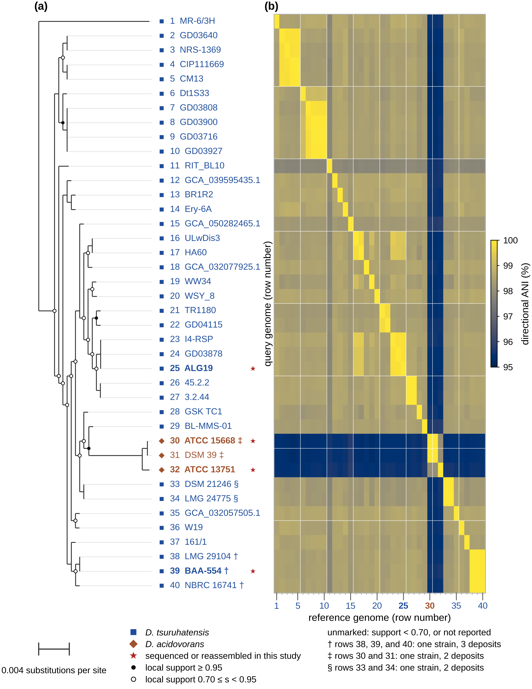

# Figure 1: phylogeny and directional ANI

**Manuscript mapping:** Fig. 1a, 40-genome phylogeny; Fig. 1b, directional
average nucleotide identity (ANI) heatmap.

This self-contained module reproduces Figure 1 from saved inputs and rebuilds
the distance-preserving 40-tip tree from the recovered 41-tip tree. It does not
infer the original species tree or recalculate ANI from assemblies. Native KBase objects and available provenance are preserved in the
[service-evidence release](../../docs/evidence-downloads.md). The original
49-COG alignment and exact historical FastTree point version remain unavailable.

## Figure preview



[Full-size PNG](reference/figure1.png) · [Vector PDF](reference/figure1.pdf) · [Caption and alt text](docs/figure1.md)

This is the saved reference output. Follow the reproduction instructions below to generate it from the supplied inputs.

## Contents

| Path within this folder | Purpose |
|---|---|
| `scripts/` | Input checking, tree correction, plotting, and validation |
| `data/` | Matrix, three trees, metadata, and pinned input checksums |
| `reference/` | Accepted figure and audit outputs; never overwritten |
| `tests/` | Regression tests and negative controls |
| `docs/figure1.md` | Accepted caption, alt text, and Methods wording |
| `docs/provenance.md` | Scientific sources and transformation history |
| `docs/methods-record.md` | Manuscript and Methods Record crosswalk |
| `docs/validation.md` | Recorded validation scope and limitations |
| `requirements.txt`, `requirements-lock.txt` | Module-specific Python versions |
| `build/` | New outputs; created when run and excluded from Git |

## Setup

Tested with Python 3.12.14 on macOS. From the repository root:

```sh
cd analyses/figure1
python3 -m venv .venv
source .venv/bin/activate
python -m pip install -r requirements.txt
```

On Windows, use `.venv\Scripts\activate` instead of `source`.
For export validation, install Poppler separately so `pdffonts` is on PATH
(`brew install poppler` on macOS or your operating system's Poppler package).
Alternatively, supply `--pdffonts /path/to/pdffonts` to the validator.
Installing dependencies needs network access; the analysis commands do not.

## Reproduce and validate

Run inside this module folder after activating the environment:

```sh
python scripts/verify_inputs.py
python -m unittest discover -s tests -v
python scripts/rebuild_tree.py --out-dir build/tree
python scripts/plot_figure1.py --output-dir build/figure1
python scripts/validate_figure1.py --output-dir build/figure1
```

The final command exits nonzero if validation fails. The tree rebuild produces
`build/tree/tree_40tips_corrected.newick`; the plotter uses the pinned,
accepted `data/tree_40tips_corrected.newick`, whose equivalence is tested.
Plotting produces `figure1.pdf`, `figure1.png`, `row_mapping.csv`,
`row_mapping.json`, and `support_audit.csv` in the chosen output folder.
On macOS, open the PDF with `open build/figure1/figure1.pdf`.

Input paths resolve relative to the scripts, not the working directory.
For example, from the repository root:

```sh
analyses/figure1/.venv/bin/python analyses/figure1/scripts/plot_figure1.py --output-dir build/figure1
```

Explicit relative output paths resolve from your current directory. The default
is this module's `build/figure1/`. Use a fresh output folder for repeat runs.
Never run with Python `-O`: some validation checks use assertions.

## Interpretation and limits

Accepted reference exports use Liberation Sans; macOS can use Arial.
Both must be embedded TrueType fonts. Fonts and library versions can affect
spacing, so generate and validate outputs in the same environment. The validator
compares complete saved images against fresh in-memory exports; it does not
assume cross-platform pixel identity.

See [input definitions](docs/data-dictionary.md), [provenance](docs/provenance.md),
and [verification records](docs/validation.md). Return to the
[repository home](../../README.md) or [analysis index](../../docs/analysis-index.md).
