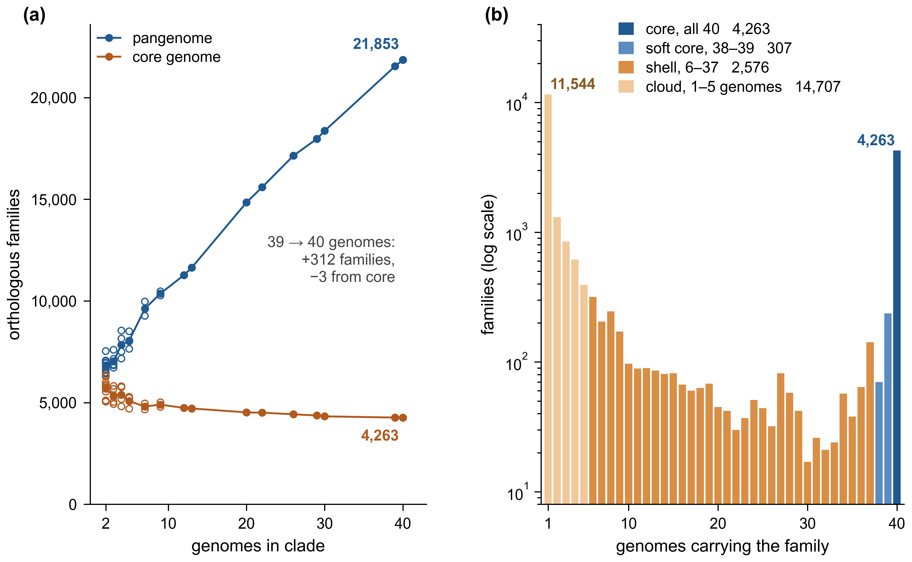

# Figure 2 — pangenome structure

Recompute Figure 2 from the archived 40-genome ortholog-family export, check the
saved tables, and render the accepted two-panel design. This module is
self-contained and does not need a KBase login or files outside the repository.

## Figure preview



[Full-size PNG](reference/figure2.png) · [Vector PDF](reference/figure2.pdf) · [Caption and alt text](docs/figure2.md)

This is the saved reference output. Follow the reproduction instructions below to generate it from the supplied inputs.

## Quick start

From the repository root:

```sh
cd analyses/figure2
python3 -m venv .venv
source .venv/bin/activate
python -m pip install -r requirements-lock.txt
python scripts/rebuild_counts.py
python scripts/plot_figure2.py --output-dir build/figure2
```

Tested with Python 3.12.14. The last command writes `figure2.pdf`, `figure2.png`,
three computed TSV tables, `summary.json`, and `execution.json`. Use the vector
PDF for the figure submission. The PNG is a 600-dpi convenience export.
Commands resolve inputs relative to the module, not the working directory.
Existing output directories are refused, even if empty; choose a new name to
repeat a run. Inputs, reference figures, and other module files are not overwritten.

## Test and validate

```sh
python -m unittest discover -s tests -v
python scripts/validate_figure2.py --output-dir build/figure2
```

The export validator additionally needs Poppler's `pdffonts` executable on PATH
(for example, install Poppler through your operating system's package manager).
Alternatively pass `--pdffonts /path/to/pdffonts`. Calculation and plotting do
not require Poppler. All analysis runs are offline after dependency installation.

For separate count outputs without plotting:

```sh
python scripts/rebuild_counts.py --output-dir build/counts
```

Without `--output-dir`, count verification is read-only. Input hashes are checked
before calculation. The tests include deliberately incorrect counts, matrix
cells, plot values, colors, and output destinations. The export validator
recomputes all inputs, checks PDF bar geometry, and compares the entire PDF
render and PNG with a fresh render in the current environment.

## Scope

- 21,853 families and 252,945 gene/genome memberships across 40 genomes.
- All 874,120 saved copy-number matrix cells and all 36 clade count records.
- Exact clade-size means (not the rounded historical summary), occupancy
  categories, endpoint differences, and both figure panels.
- Matching clade membership in the historical accumulation tree and the corrected
  Figure 1 tree; branch lengths and support values are not used for Figure 2.

This is **postprocessing of archived family assignments**, not a rerun or
independent biological validation of gene prediction or OrthoMCL clustering.
The clades are not independent random samples. These plots do not constitute
randomized rarefaction or a fitted test of pangenome openness.

## Files and records

- `data/`: immutable source export, saved tables, trees, and input checksums.
- `scripts/`: calculation, rendering, and exported-figure validation.
- `tests/`: regression and failure tests.
- `reference/`: accepted reference PDF and PNG, not newly computed evidence.
- [Caption and alt text](docs/figure2.md).
- [Input provenance and definitions](docs/provenance.md).
- [Recorded verification and limits](docs/validation.md).

Arial is preferred, with embedded TrueType alternatives if unavailable. Exact
pixels can vary with fonts or dependency versions; the numerical checks do not.
The reference was rendered with Arial. No new licence or public-release approval
is conferred by this module; see the repository release checklist.
