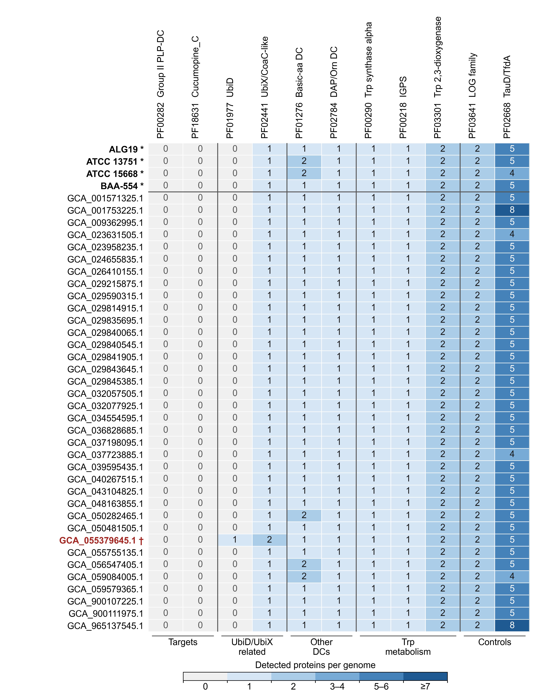

# Figure 3: detected protein families

Reproduce the 40-genome by 11-family heatmap from archived counts, with an independent sequence-search cross-check. The transposed 170 × 220 mm design uses 8-point text, explicit zeros, and embedded TrueType fonts. None of the 440 displayed values differs from the historical figure.

## Figure preview



[Full-size PNG](reference/figure3.png) · [Vector PDF](reference/figure3.pdf) · [Caption and alt text](docs/figure3.md)

This is the saved reference output. Follow the reproduction instructions below to generate it from the supplied inputs.

## Run

From this module directory:

```sh
python3 -m venv .venv
source .venv/bin/activate
python -m pip install -r requirements-lock.txt
python scripts/plot_figure3.py --output-dir build/figure3
python -m unittest discover -s tests -v
python scripts/validate_figure3.py --output-dir build/figure3
```

Commands find module inputs relative to the script, not the working directory. Plotting is offline after dependency installation. Use a new output directory for every run: existing directories, source-data locations, and reference locations are refused. The validator needs Poppler's `pdffonts` on PATH, or `--pdffonts /path/to/pdffonts`.

Outputs are `figure3.pdf`, `figure3.png`, `displayed_counts.tsv`, and `execution.json`. Use the vector PDF for figure submission. The PNG is a 600-dpi convenience export.

## Validation scope

- All 520 archived cells for 13 families matched independent Pyrodigal 3.7.1/PyHMMER 0.12.2 per-genome searches of the 40 original FASTAs and the exact Pfam database.
- The independent run regenerated all 239,999 predicted proteins, including identical per-genome totals. FASTA hashes matched the archived manifest.
- PF18631, searched separately in the historical work, was independently negative in all 40 genomes. Its zero values are explicit searched results, not missing values filled with zeros.
- Figure rendering tests cover all 440 cells, labels, highlighting, color bins, dimensions, clipped text, exported PDF numerals, and full PNG/PDF rendering comparisons.

The self-contained plot does not rerun upstream annotation or searches. It checks the archived CSV and separate PF18631 report against the independent-search counts and hit records supplied in `data/`. An optional sequence-level reproduction script is supplied separately; it requires the original 40 FASTAs, recorded manifest, and full Pfam database, which are not bundled in this figure module. See [provenance](docs/provenance.md) for exact requirements and scope.

This is computational reproduction, not biochemical validation. Original project
contributions are covered by the repository's [code](../../LICENSE) and
[data](../../DATA_LICENSE.md) licenses, subject to [third-party terms](../../docs/licensing-scope.md).
The [v1.0.0 archive](https://doi.org/10.5281/zenodo.23219657) includes this module and the underlying search-evidence packages.

- [Caption, alt text, and manuscript edits](docs/figure3.md)
- [Provenance and search arrangement](docs/provenance.md)
- [Validation record](docs/validation.md)
