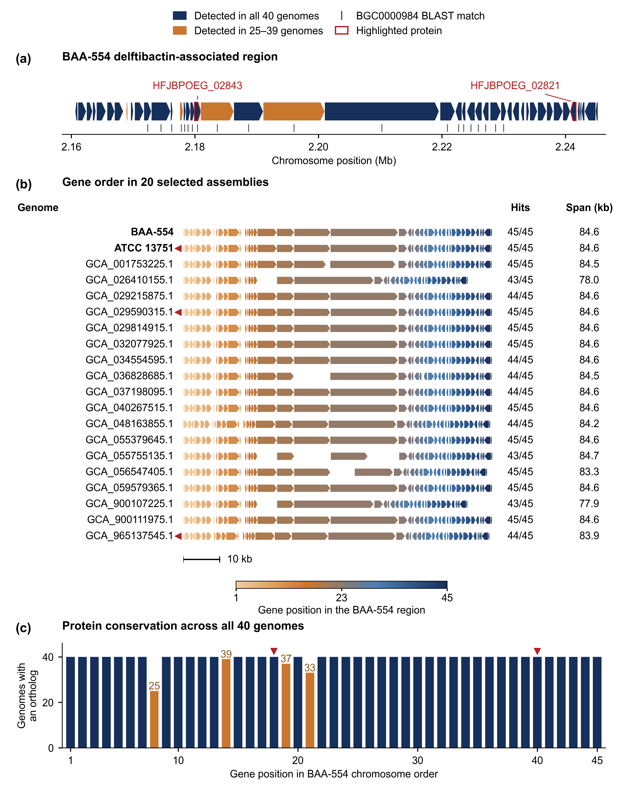

# Figure 4: delftibactin-associated locus

Self-contained plotting, validation, and region-restricted reciprocal-search
reproduction for the three-panel Figure 4. The corrected figure shows **20**
assemblies in panel (b), not the historical 19.

## Figure preview



[Full-size PNG](reference/figure4.png) · [Vector PDF](reference/figure4.pdf) · [Caption and alt text](docs/figure4.md)

This is the saved reference output. Follow the reproduction instructions below to generate it from the supplied inputs.

## What is reproducible here?

- Plotting all 45 reference genes, 20 cluster matches, 20 comparative tracks,
  and 45 whole-panel conservation bars from the supplied inputs.
- Repeating the historical region-restricted search: all 1,293 rows reproduced.
- Repeating the corrected CDS-feature extraction and reciprocal search: 1,344
  rows, preserving all historical rows and recovering 51 additional matches.
- Checking source coordinates, rendered gene orientation, row counts/spans,
  conservation-bar heights, labels, the 10 kb scale, fonts, and PDF/PNG exports.

**Panel (c): complete pair-level evidence supporting the current analysis.**
The selected complete execution in `reconstruction/full_panel_repeat/results/`
contains all 1,800 decisions and 1,774 accepted reciprocal matches. The
[current-analysis record](CURRENT_ANALYSIS.md) identifies its inputs, settings,
and exact verification commands. A separate aggregation verifies all 45 gene
counts and all 40 genome and contig counts against the plotted tables.
Existing execution and comparison records remain intact. Figure 4a and the
region selections have an additional [antiSMASH evidence package](../../supporting-analysis/antismash/README.md),
with a separately distributed native-output archive. This package does not
rerun antiSMASH.

## Environment

Tested with Python 3.12.14 on macOS arm64. From this module's folder:

```sh
python3 -m venv .venv
source .venv/bin/activate
python -m pip install -r requirements-lock.txt
```

For export validation, install Poppler through your normal package manager
(for example, `brew install poppler` on macOS). The plot itself does not need
Poppler. Use `--pdffonts /absolute/path/to/pdffonts` if it is not on PATH.

## Generate and verify the figure

```sh
python -m unittest discover -s tests -v
python -m unittest discover -s reconstruction/tests -v
python reconstruction/bin/validate_evidence.py --results reconstruction/evidence
python reconstruction/bin/validate_evidence.py --results reconstruction/full_panel_repeat/results
python scripts/verify_current_analysis.py --module . --output build/current-analysis-check
python scripts/plot_figure4.py --output-dir build/figure4
python scripts/validate_figure4.py --output-dir build/figure4
```

The vector PDF is `build/figure4/figure4.pdf`; its 600-dpi PNG is beside it.
Outputs include the exact plotted data and software versions. Choose a fresh
output directory for each run; existing results are never overwritten.
Reference outputs are in `reference/`. They are not inputs to plotting.
Fonts can differ across computers; validation compares a fresh render in the
current environment, not an unsupported promise of cross-platform byte identity.

## Repeat the upstream region-restricted searches

All 40 selected antiSMASH GenBank regions are included. No raw reads or full
genomes are needed, and no network access is needed after installation.

```sh
python scripts/rerun_region_search.py --parser historical --output-dir build/historical-search
python scripts/rerun_region_search.py --parser feature --output-dir build/corrected-search
```

Each full run takes several minutes on the tested computer. Searches use
PyHMMER 0.12.2 `phmmer`, `E=1e-5`, one CPU, lowest-E-value hits in both
directions, and reciprocal agreement. The `historical` parser deliberately
reproduces the old identifier-extraction limitation. The default `feature`
parser reads each CDS independently and accepts `locus_tag`, `gene`, or `ID`.
Both modes actually run searches, including the BAA-554 self-comparison.

Expected comparisons against the historical table:

| Mode | Rows | Missing | Additional |
|---|---:|---:|---:|
| Historical | 1,293 | 0 | 0 |
| Feature-aware | 1,344 | 0 | 51 |

The 51 additions belong to GCA_029835695.1 (15; 7 to 22 matches) and
GCA_037198095.1 (36; 8 to 44). Only the latter passes the at-least-43
selection rule, so the displayed subset increases from 19 to 20.

## Files and manuscript use

- [Current analysis and pair-to-plot verification](CURRENT_ANALYSIS.md)
- [antiSMASH supporting evidence and companion archive](../../supporting-analysis/antismash/README.md)
- [Caption and alt text](docs/figure4.md)
- [Source provenance and correction](docs/provenance.md)
- [Validation scope](docs/validation.md)
- [Whole-proteome evidence, inputs, and reconstruction](reconstruction/README.md)
- `data/region_gene_order.tsv`: unchanged historical table.
- `data/region_gene_order_corrected.tsv`: corrected plot input.
- `data/regions/`: selected GenBank regions; selections are explicitly recorded
  rather than depending on directory traversal order.
- `data/knownclusterblast_all.json`: all 40 archived source texts, with hashes;
  encoding each `text` value as UTF-8 restores the original file bytes.
- `data/*search_evidence.json`: forward/reverse best-hit evidence from the fresh runs.
- `data/input_checksums.json` and `SHA256SUMS.txt`: integrity manifests.

The figure is 170 x 220 mm as a readability choice, not a required journal size.
The tall layout, 8-point essential labels, and vector PDF support manuscript use.
No claim of experimentally established delftibactin or harmane production is made.
