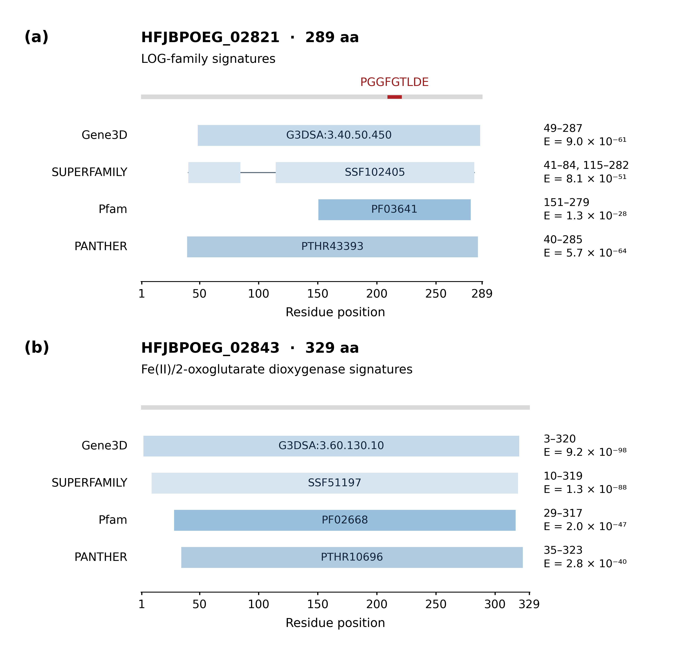

# Figure 5: protein-domain assignments

Self-contained reconstruction of the **figure** from archived InterProScan output,
not a new InterProScan run. The two proteins and eight annotations are unchanged.
The readable 170 x 160 mm layout uses a common residue scale, 7.5-11 pt text,
embedded TrueType fonts, a vector PDF, and a 600 dpi PNG.

## Figure preview



[Full-size PNG](reference/figure5.png) · [Vector PDF](reference/figure5.pdf) · [Caption and alt text](docs/caption-and-alt-text.md)

This is the saved reference output. Follow the reproduction instructions below to generate it from the supplied inputs.

## Run

From this directory, with Python 3.12 (the tested interpreter):

```sh
python3 -m venv .venv
source .venv/bin/activate
python -m pip install -r requirements-lock.txt
python -m unittest discover -s tests -v
python scripts/plot_figure5.py --output-dir build/figure5
python scripts/validate_figure5.py build/figure5
```

Use a fresh output directory for each run. Existing outputs and source data are
never overwritten. Commands also work from another directory when the script
and output paths are explicit. This workflow needs no network after installation.

## Files

- `data/`: unmodified two-protein FASTA, original TSV and JSON, and input hashes.
- `scripts/`: input reconciliation, plotting, and independent PDF validation.
- `tests/`: source corruption, exported-geometry mutation, and no-overwrite tests.
- `reference/`: checked PDF, PNG, and plotted annotation table in JSON form.
- `docs/`: caption, alt text, provenance, and validation scope.

## What changed in the display

The original TSV-based figure drew SUPERFAMILY SSF102405 as a continuous span
from residue 41 to 282. The richer archived JSON identifies two matched fragments,
41-84 and 115-282. The new plot draws these separately with a thin connector.
Residues 85-114 are not part of either matched fragment; this is not evidence of
a deletion in the protein. All other seven matches are continuous.

Protein lengths (289 and 329 aa), all eight E-values, and the motif position
(211-219) agree with the archived data. The motif is located directly in the
FASTA sequence; it is not an InterProScan feature. The current rendering uses
one-based inclusive residue intervals, with bar edges at half-residue boundaries.

## Interpretation and limitations

Panel (a) supports a LOG-family assignment, rather than the historical
lysine-decarboxylase product name. Panel (b) supports a Fe(II)/2-oxoglutarate
dioxygenase-family assignment. These are sequence-based predictions, not
measurements of enzyme activity or evidence of harmane synthesis.

TSV E-values correspond to location-level values for Gene3D and Pfam, and
match-level values for SUPERFAMILY and PANTHER. They are preserved as reported,
rounded to two significant figures in the graphic, and must not be used to rank
support across different libraries. The JSON retains full precision.

The validator checks the PDF itself against the archived sources, including all
nine segment rectangles, full-protein lengths, displayed ranges and E-values,
the motif, font embedding, text bounds, and page size. Negative controls show
that a filled gap, shifted segment, changed E-value, shifted motif, or changed
protein length is rejected. Visual inspection remains necessary; passing tests
is not a guarantee of every possible biological or typographic property.

This module does not repeat the 2026 web-service execution, reconstruct missing
service settings, or experimentally validate the annotations.
